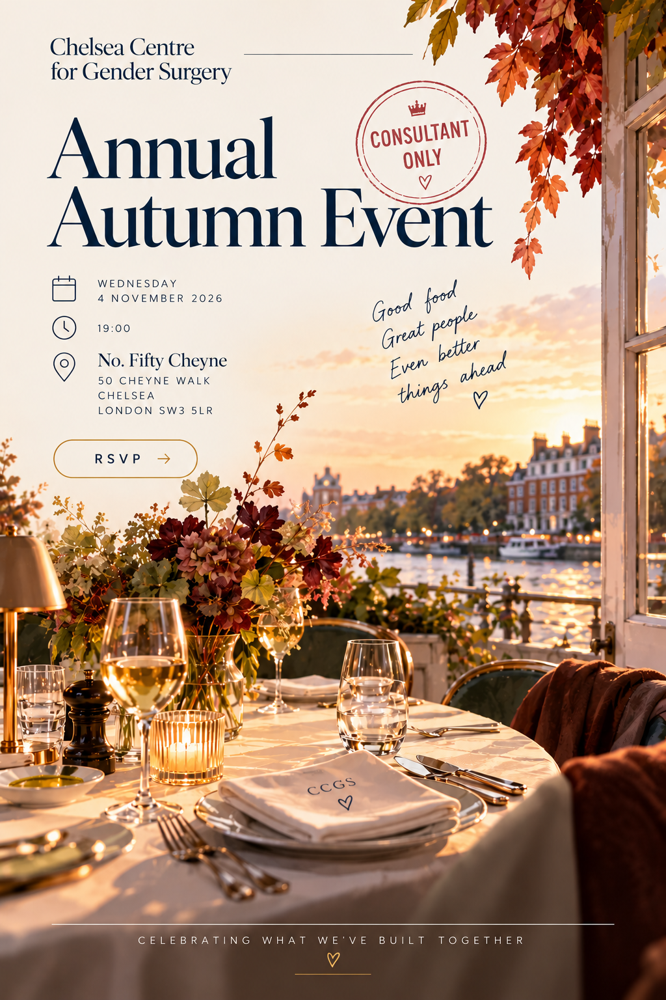
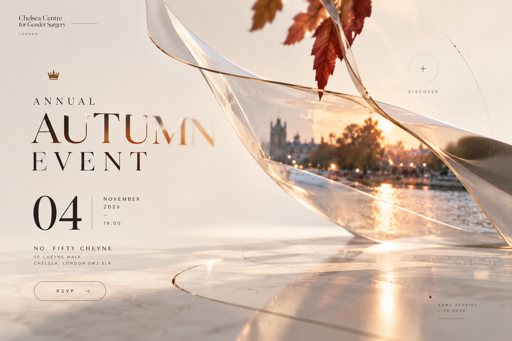

> Current owner correction (20 October 2026): all references are conceptual. No serif typography, no literal reproduction of the mockup, no rigid bow. The reattached landscape PNG matches `subtractive-direction.png` exactly. See the manifest for limits.

# Visual references

All four PNGs below are stored in this repository. No separate bundle is required.

The [manifest](manifest.json) records provenance, approval status, usage limits, dimensions, byte lengths and SHA-256 checksums. Each file was recovered from the existing handoff archive and independently matched byte for byte to the source conversation on 20 October 2026. Signed download URLs are intentionally not stored.

Read [creative direction](../../docs/CREATIVE-DIRECTION.md) before using these images. They are concept artwork, not verified photographs of the venue. The filenames retain the source handoff names; a filename alone does not establish approval.

| Reference | Status | Use |
| --- | --- | --- |
| [Approved flyer](approved-flyer.png) | Approved visual ancestor | Preserve warmth, autumn light, visual family and approved event identity. |
| [Subtractive direction](subtractive-direction.png) | Concept approved; contrast and visibility need refinement | Main compositional direction for the digital experience. |
| [Spatial exploration](spatial-exploration.png) | Superseded exploration | Process context only; do not reproduce its crowded circular discoveries. |
| [Warm hero ancestor](warm-hero-ancestor.png) | Earlier visual reference with rejected copy | Atmosphere only; never reuse the family headline, guest count or old footer. |

## Approved flyer

## Digital direction

## Limits of the transfer

The complete four-image handoff set is present. This is not a complete archive of every conversation turn. Other intermediate flyers, third-party research imagery and the rejected atom prototype are not implementation assets in this transfer. No missing image is represented by a placeholder, a generated replacement or a claimed upload.

The existing creative and content documents remain authoritative. RSVP remains unconfigured and discovery facts require sources. The next implementation milestone is M1, followed by creative approval before M2.

## Sourced story imagery — 21 October 2026

The four approved concept PNGs above remain concept references. Actual website photographs and the neighbourhood map are stored separately in `public/images/chelsea/`, with source URLs, descriptions, credit, processing, byte sizes and SHA-256 hashes in that directory’s `manifest.json`. No inaccessible image is represented as downloaded.
